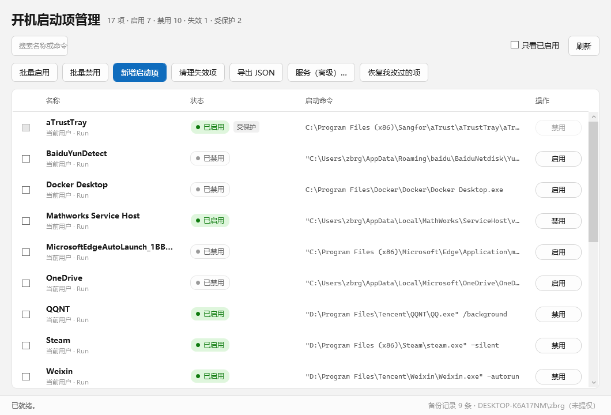
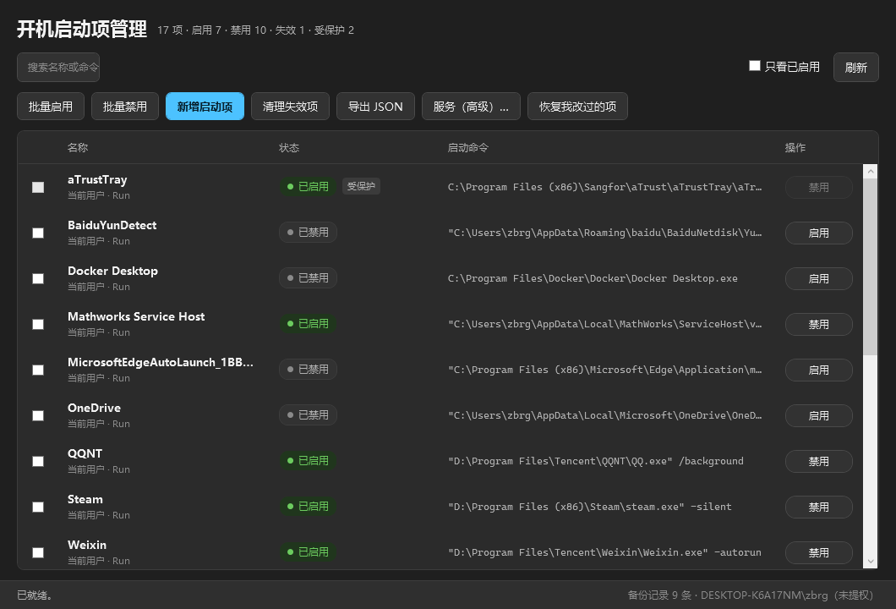
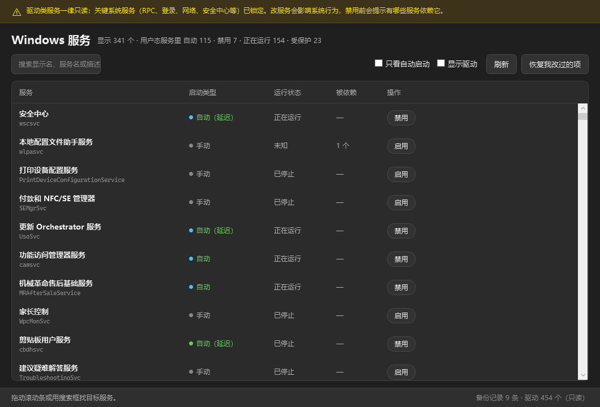

# 开机启动项管理（StartupToggle）

开关 Windows 11 开机启动项的小工具：只改系统自己的“启用 / 禁用”状态位，**Run 值和快捷方式一个字节都不动**，任何改动都能一键恢复。
另有一个独立的“服务（高级）”视图，可以开关用户态 Windows 服务（驱动程序一律只读）。

## 为什么这么做

任务管理器里把一个启动项“禁用”，并不是删除它，而是往
`…\Explorer\StartupApproved\Run` 写一条 12 字节的状态（首字节 `03` 禁用、`02` 启用），
`HKCU/HKLM\…\Run` 里的原值、启动文件夹里的 `.lnk` 原封不动。

本软件采用同一套机制，因此：

- 任务管理器里看到的状态与本软件**完全一致**，不会出现“这边关了那边还开着”；
- 每次写入前都把原始字节记进备份文件，随时可以退回；
- 不做隔离、不改名、不删值，用户的启动项数据不会丢。

## 界面

启动项（浅色）：



启动项（深色，本机当前就是深色）：



服务（高级）：



三张图都是自测里**离屏渲染**出来的真实窗口，不是手绘示意图。

## 覆盖的位置

| 位置 | 说明 |
| --- | --- |
| `HKCU\Software\Microsoft\Windows\CurrentVersion\Run` | 当前用户 |
| `HKLM\Software\Microsoft\Windows\CurrentVersion\Run` | 所有用户 |
| `HKLM\Software\WOW6432Node\Microsoft\Windows\CurrentVersion\Run` | 所有用户（32 位项） |
| 用户启动文件夹 | `%APPDATA%\Microsoft\Windows\Start Menu\Programs\Startup` |
| 公共启动文件夹 | `%ProgramData%\Microsoft\Windows\Start Menu\Programs\Startup` |
| 其它用户的 Run | 仅只读展示（`HKEY_USERS`） |
| `HKLM\SYSTEM\CurrentControlSet\Services` | 服务视图单独处理，见下文 |

**不做**：计划任务、RunOnce、UWP 启动应用。

## 功能

- 列表：名称、启动命令、所在位置、启用状态；失效项与受保护项带标签
- 搜索（名称 / 命令 / 位置）、只看已启用、刷新
- 单项开关：点一下立即生效，不弹框
- 批量启用 / 禁用：勾选后弹一次汇总确认
- 新增启动项：写入当前用户或所有用户的 Run（含空格路径自动加引号）
- 清理失效项：删除启动项本身，删除前记录命令行
- 导出 JSON：整份清单快照
- 恢复我改过的项：把备份文件里的原始状态逐条写回（启动项与服务共用）
- 服务（高级）：独立窗口开关用户态服务，驱动只读，见下文
- 主题跟随系统（`AppsUseLightTheme`，并响应 `WM_SETTINGCHANGE` 实时切换）

## 保护名单

以下项在界面上置灰、无法勾选和开关（`src/StartupToggle.Core/ProtectionPolicy.cs`，按名称匹配，含 32 位位置）：

| 名称 | 原因 |
| --- | --- |
| `SecurityHealth` / `SecurityHealthSystray` | Windows 安全中心托盘 |
| `aTrustTray` | 深信服零信任客户端，禁用可能影响公司内网 / VPN 准入 |

## 产物与运行要求

两种产物，都已构建并校验过：

| 产物 | 大小 | 目标机器要求 |
| --- | --- | --- |
| `dist\StartupToggle.exe` | 56.8 MB，**单文件** | 不需要装任何运行时，拷走就能跑 |
| `dist-fd\StartupToggle.exe` | 240 KB，5 个文件 | 需要 .NET 9 Desktop Runtime（本机已具备） |

- exe 清单为 `requireAdministrator`：双击即申请管理员，改 HKLM / 公共启动文件夹必须要它
- 重新生成：`publish.ps1`（框架依赖）或 `publish.ps1 -SelfContained`（单文件，首次需联网下载运行时包）

## 构建与自测

```powershell
# 构建全部
dotnet build StartupToggle.sln -m:1

# 自测：161 项，含进程内跑真实启动流程 + 三张窗口渲染出图到 docs\
dotnet build tests\StartupToggle.SelfTest\StartupToggle.SelfTest.csproj -m:1
.\tests\StartupToggle.SelfTest\bin\Debug\net9.0-windows\StartupToggle.SelfTest.exe

# 环境自查：当前进程到底能不能写 HKCU、能不能写 %LOCALAPPDATA%
.\tests\StartupToggle.SelfTest\bin\Debug\net9.0-windows\StartupToggle.SelfTest.exe --probe-io

# 真实写入验证：挑一条 HKCU 启动项，禁用→启用→按原始字节还原，Run 值不碰
.\tests\StartupToggle.SelfTest\bin\Debug\net9.0-windows\StartupToggle.SelfTest.exe --live-write

# 发布
.\publish.ps1                  # 框架依赖
.\publish.ps1 -SelfContained   # 自包含单文件
```

> 如果脚本直接运行报 `AuthorizationManager 检查失败`，是 PowerShell 的执行策略拦的，
> 用 `powershell -NoProfile -ExecutionPolicy Bypass -File .\publish.ps1` 即可。

`-m:1` 是必需的：在受限环境里并行构建会失败（节点间通信被拦）。

自测覆盖：状态位编解码、命令行解析（含未加引号带空格的路径）、五个位置的扫描、
保护名单、开关写入与备份、一键恢复、清理失效项、新增启动项、JSON 导出、
真实注册表只读扫描，以及**在进程内跑真实启动流程 + 双主题离屏渲染出图**。

> `--live-write` 需要进程能写 HKCU。如果它报 `Access is denied`，先用 `--probe-io` 看组列表：
> 被沙箱套上**受限令牌**的进程，组里会缺少本人账户组、出现 `\None`，这种会话下任何进程都写不了
> HKCU，也不是产品的问题。正常双击运行时不受影响。

## 备份文件

`%LOCALAPPDATA%\StartupToggle\backup.json`

每条记录包含：时间、位置、名称、写入前的原始 12 字节（没有则为 null）、当时的命令行、动作类型；
服务记录额外带 `Kind: "service"` 和写入前的 `OriginalStart`。

“恢复我改过的项”按 (位置, 名称) 取**最早**一条记录写回——因为我动手之前的状态才是要回到的状态：
若按最后一条恢复，“禁用→再启用→恢复”会把你退回到禁用这个中间态。
启动项写在 null 时会把状态值删掉（即回到“系统默认启用”），服务写回原始 Start。

## 服务（高级）

主窗口工具栏右上角有 **服务（高级）…**，点开是独立窗口（`ServicesWindow`），和启动项分开：

| 项 | 做法 |
| --- | --- |
| 开关对象 | 用户态 Windows 服务，读 `HKLM\SYSTEM\CurrentControlSet\Services\<名>\Start` |
| 关闭 | `Start=4`（禁用）+ 尝试停止正在运行的实例（最长等 8 秒） |
| 开启 | `Start=2`（自动），保留原有的 `DelayedAutoStart` 延迟标志，不替你启动 |
| 只读 | 驱动类（内核/文件系统/适配器/识别器）**一律**只读；`Boot`/`System` 启动类型只读 |
| 关键服务 | `RpcSs`、`DcomLaunch`、`Power`、`ProfSvc`、`SamSs`、`EventLog`、`Winmgmt`、`CryptSvc`、`Schedule`、`mpssvc`、`BFE`、`Dnscache`、`Dhcp`、`NlaSvc`、`WinDefend` 等 23 个锁死 |
| 厂商保护 | `aTrust*` / `Sangfor*` 前缀锁死，与启动项侧 aTrustTray 的处理一致 |
| 依赖提示 | 每行显示“被依赖 N 个”；禁用前把依赖它的服务名列出来 |
| 默认过滤 | 默认隐藏 454 个驱动，可用“显示驱动”打开；支持搜索与“只看自动启动” |

服务侧用的是**同一份备份文件和同一个恢复引擎**，所以两个窗口点“恢复我改过的项”效果一致。

## 冒烟清单（需要你手动过一遍 UAC）

1. 右键 `dist\StartupToggle.exe` → 以管理员身份运行，界面打开，列表显示 17 项。
2. 找到 **Docker Desktop**（当前应为“已禁用”），点“启用”，该行变成“已启用”。
3. 打开任务管理器 → 启动应用，确认 Docker Desktop 也显示为“已启用”。
4. 回到本软件点“禁用”，再到任务管理器确认同步变为“已禁用”。
5. 点“恢复我改过的项”，确认两处都回到最初的“已禁用”，底部“备份记录”归零。
6. 确认 `aTrustTray`、`SecurityHealth` 的开关为灰、勾选框点不动；点“导出 JSON”能落盘。

服务侧冒烟（7–9）：

7. 点“服务（高级）…”，搜索 `LDPlayer`，应看到 **LeiDian（LDPlayerSvr）**，启动类型“自动”、状态“正在运行”。
8. 点它的“禁用”：确认框应提示依赖数量（0 个），确认后该行变成“禁用”、状态“已停止”；
   打开 `services.msc` 找到 LeiDian，确认也显示为“禁用”。
9. 点“恢复我改过的项”，确认 LeiDian 回到“自动”；顺手确认 `RpcSs`、`BFE`、`aTrustService` 的按钮是灰的，
   “显示驱动”勾上后所有驱动行也都是灰的。

替代方案：启动项侧可以用 `--live-write` 自动跑一遍；服务侧可以用 `--probe-services` 先看锁定规则和雷电是否可操作。

附加观察项：`HKLM\…\WOW6432Node\…\StartupApproved\Run` 在本机原本不存在，
第一次禁用 32 位项（如 `RadminVPN`）时本软件会创建它，需要确认任务管理器也认这个状态。

## 已知边界

- 启动文件夹条目的失效判定只看 `.lnk` 文件是否存在，不解析快捷方式指向的目标
- 切到“其它用户”的启动项只读，不支持写入（提权进程的 HKCU 属于管理员账户，跨用户写容易改错地方）
- 若进程账户与桌面登录账户不一致，顶部黄条会提示，HKCU 项会写进当前进程账户
- 服务侧只做“自动 ↔ 禁用”两态；不改“手动”，也不支持批量（服务误操作的代价比启动项高得多）
- 服务停止若超时会如实提示“下次开机会是停止状态”，注册表侧的禁用照样生效
- 极少数受保护服务（如 `wlpasvc`）非提权查询会拿不到运行状态，显示“未知”，不影响开关

## 项目结构

```
StartupToggle/
├── StartupToggle.sln
├── publish.ps1                     发布脚本（-SelfContained 需联网）
├── src/
│   ├── StartupToggle.Core/         全部注册表逻辑，无 UI 依赖
│   │   ├── Models.cs               StartupItem / 位置枚举 / 状态位编解码
│   │   ├── RegistryPaths.cs        全部硬编码的注册表路径
│   │   ├── RegistryGateway.cs      注册表访问接口 + 真实实现（便于自测替换）
│   │   ├── StartupScanner.cs       枚举五个位置（含其它用户只读）
│   │   ├── StartupManager.cs       启动项唯一写入口：先备份再写状态位
│   │   ├── RestoreEngine.cs        恢复引擎：启动项与服务共用，按最早记录写回
│   │   ├── BackupStore.cs          backup.json 读写与去重
│   │   ├── CommandLineParser.cs    命令行拆解、引号处理、存在性判断
│   │   ├── ProtectionPolicy.cs     启动项保护名单 + 账户对照
│   │   ├── JsonExporter.cs         清单导出
│   │   └── Services/               Windows 服务侧
│   │       ├── ServiceModel.cs     ServiceInfo / 启动类型 / 运行状态
│   │       ├── ServiceProtection.cs 驱动只读 + 23 个关键服务 + 厂商前缀
│   │       ├── ServiceControl.cs   SCM 的 P/Invoke 封装（查询/停止/启动）
│   │       ├── ServiceScanner.cs   枚举 Services 键、解析间接字符串、算反向依赖
│   │       └── ServiceManager.cs   服务写入口：Start=2/4，禁用后停服务
│   └── StartupToggle.App/          WPF 外壳
│       ├── App.xaml(.cs)           启动、全局异常、主题
│       ├── MainWindow.xaml(.cs)    启动项列表、工具栏、批量与确认
│       ├── ServicesWindow.xaml(.cs) 服务（高级）独立窗口
│       ├── AddItemWindow.xaml(.cs) 新增启动项对话框
│       ├── StartupRow.cs           启动项行视图模型
│       ├── ServiceRow.cs           服务行视图模型
│       ├── ThemeManager.cs         跟随系统主题 + WM_SETTINGCHANGE
│       ├── Themes/                 Light.xaml / Dark.xaml / Controls.xaml
│       ├── app.manifest             requireAdministrator
│       └── app.asinvoker.manifest   仅开发期免提权预览
└── tests/StartupToggle.SelfTest/   控制台自测
    ├── Program.cs                  161 项断言（临时文件落在仓库 .tmp\，不依赖 %TEMP%）
    ├── FakeRegistryGateway.cs      内存版注册表，让写入逻辑无需提权即可验证
    ├── ServicesTest.cs             服务侧 33 项断言（锁定规则、Start 写入、恢复）
    ├── UiHarness.cs                进程内跑启动流程 + 三张窗口渲染出图
    ├── LiveWriteTest.cs            --live-write：真写 HKCU 后按原始字节还原
    ├── ServiceProbe.cs             --probe-services：真实服务扫描抽样
    └── IoProbe.cs                  --probe-io：打印令牌、组、注册表与文件可写性
```
